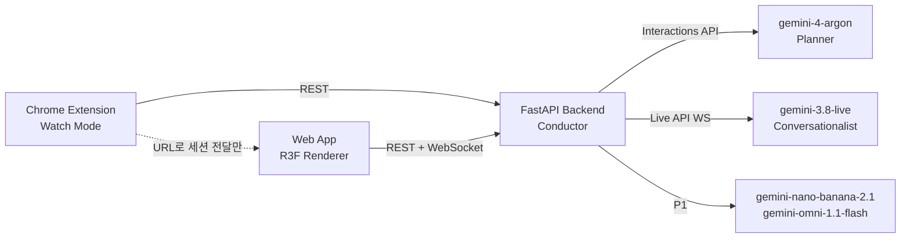
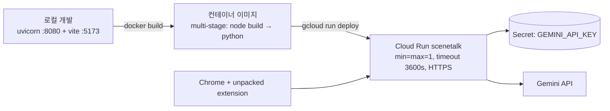
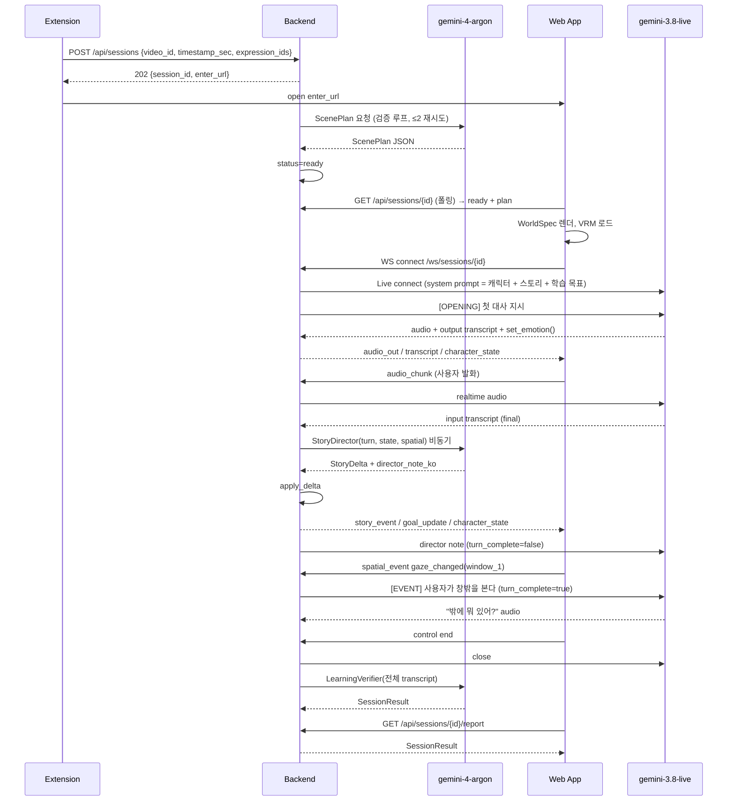

# SceneTalk — 서비스 아키텍처 및 개발명세서

**버전:** 1.0 (build substrate)
**작성일:** 2026-10-16
**상위 문서:** `ideation.md` (SceneTalk 최종 서비스 기획서 v2.0 — 확정본)
**용도:** Antigravity에서 Gemini 4 Argon(`gemini-4-argon`)에게 SDD(spec-driven development)로 구현을 위임하기 위한 단일 입력 문서
**해커톤:** Google DeepMind AI Hackathon 2026 · Track 1 — Gemini 4 Argon in Entertainment · 개발 시간 11:20~15:20

---

## 0. 이 문서를 읽는 방법

- **Part A(아키텍처)** 는 독립적으로 구현되는 단위들이 서로 어긋나지 않도록 묶는 **불변 결정(AD-n)** 이다. 코드는 이 결정을 따라야 하고, 바꾸려면 이 문서를 먼저 바꾼다.
- **Part B(개발명세)** 는 Argon이 바로 코드로 옮길 수 있는 **구조·스키마·API·프로토콜·프롬프트·테스트·순서** 다. 세부 구현은 코드가 소유한다. 코드와 문서가 다르면, Part A는 문서가 우선하고 Part B는 코드가 우선한다.
- `[ASSUMPTION]` 태그는 기획서에서 확정되지 않아 작성자가 가정한 지점이다. Antigravity에 넣기 전에 0.1절 표를 보고 수정한다.
- 우선순위는 기획서 12장을 따른다. **P0 End-to-End(시청 → 진입 → 대화 → 스토리 변화 → 리포트)가 먼저**, P1은 P0가 배포·녹화된 뒤에만 착수한다.
- 모델 ID와 API 사용법은 해커톤 Builder Guide(`source-guide.md`)와 Antigravity에 설치된 공식 Gemini 스킬(`gemini-api-dev`, `gemini-live-api-dev`)이 최종 권위다. 이 문서의 SDK 코드 조각은 **형태를 보여주는 참고**이며, 필드명이 다르면 스킬을 따른다.

### 0.1 `[ASSUMPTION]` 요약 — 착수 전 확인

| # | 가정 | 위치 | 틀렸을 때의 대안 |
|---|---|---|---|
| A1 | 브라우저는 Gemini Live에 직접 붙지 않고 FastAPI WebSocket 프록시를 거친다 | AD-2 | ephemeral token으로 브라우저 직결. 단, Story Director가 대화 transcript를 받으려면 클라이언트가 transcript를 별도 POST해야 함 |
| A2 | 세션·스토리 상태는 백엔드 인메모리(단일 Cloud Run 인스턴스) | AD-11 | Firestore 컬렉션 `sessions/{id}` 로 교체. 인터페이스는 `SessionStore` 프로토콜로 격리해 둠 |
| A3 | 장면 분석 입력으로 공개 YouTube URL + 시작/종료 오프셋을 Gemini에 직접 전달할 수 있다 | §13.1 | 자막 텍스트 창(±60초)만으로 분석 |
| A4 | 자막은 YouTube에서 긁지 않고 **사전 준비된 JSON**을 백엔드가 서빙한다 (데모 영상 1편) | §14, §16 | YouTube 자막 트랙 파싱(시간 부족 시 보류) |
| A5 | 데모 영상 ID(`DEMO_VIDEO_ID`)와 자막 대본은 현장에서 사용 권한이 확보된 영상으로 채운다 | §16 | 팀이 직접 촬영/제작한 짧은 영상 또는 라이선스 확인된 클립 |
| A6 | P0 캐릭터는 `pixiv/three-vrm` 저장소에 포함된 샘플 VRM 1종(MIT)을 사용 | AD-9 | VRoid Hub에서 사용 조건이 "상업/개변 가능"인 모델 다운로드 |
| A7 | 장면 생성은 Argon **단일 호출**(SceneContext + WorldSpec + CharacterSpec + 초기 StoryState를 한 JSON으로) | AD-3, §13.1 | 기획서 9.1/9.2처럼 두 호출로 분리(지연 2배) |
| A8 | 3D 템플릿은 P0에서 `cafe` 와 `generic_room` 2종만 구현 | AD-8 | 시간이 남으면 `classroom`, `street`, `park`, `apartment` 추가 |
| A9 | 사용자 인증 없음, 세션은 URL의 `session_id` 만으로 접근 | AD-10 | Deferred |
| A10 | Cloud Run에 WebSocket + 요청 타임아웃 3600초 설정 가능 | AD-12 | WS 세션을 50분 이내로 제한하고 재연결 로직 추가 |

---

# Part A — 서비스 아키텍처

## 1. 설계 패러다임: Planner / Renderer / Conversationalist 분리

기획서 마지막 문단의 원칙을 아키텍처의 최상위 패러다임으로 승격한다.

| 역할 | 담당 | 책임 | 하지 않는 것 |
|---|---|---|---|
| **Planner** (계획·판정) | Gemini 4 Argon | 장면 이해, 세계/캐릭터 명세 생성, 스토리 방향 결정, 학습 평가 | 실시간 음성, 프레임 단위 반응 |
| **Renderer** (표현) | Three.js / React Three Fiber / three-vrm | WorldSpec을 3D로 그리기, 캐릭터 상태를 표정·동작으로 표현, 시선·선택 이벤트 생산 | 스토리 결정, 학습 판정 |
| **Conversationalist** (대화) | Gemini 3.8 Live | 캐릭터 목소리로 실시간 한국어 대화, 즉각적 감정 신호(함수 호출) | 스토리 상태 소유, 학습 평가 |
| **Conductor** (중재) | FastAPI 백엔드 | 세 역할 사이의 유일한 통로. 세션·스토리 상태 소유, Live 프록시, Argon 호출, 검증 루프 | UI, 렌더링 |

**의존 방향 (규칙이다):**



- 클라이언트(확장, 웹앱)는 **절대 Gemini API를 직접 호출하지 않는다.** API 키는 백엔드에만 존재한다.
- 확장과 웹앱 사이에는 메시징이 없다. 확장은 세션을 만들고 URL을 열 뿐이다.
- Planner 출력은 항상 **JSON 명세**다. Argon이 Three.js 코드를 런타임에 생성하지 않는다 (코드 생성은 개발 시점에 Antigravity에서만).

## 2. 시스템 컨테이너

```mermaid
flowchart TB
  subgraph Browser["사용자 브라우저 (Chrome)"]
    YT[YouTube 탭]
    CS[content.js<br/>currentTime 폴링]
    SP[Side Panel UI<br/>학습 자막 · 표현 해설 · Enter the Scene]
    WEBAPP[SceneTalk Web App<br/>/enter · /scene · /result]
    YT --- CS --> SP
  end

  subgraph CloudRun["Google Cloud Run — 서비스 1개 (HTTPS)"]
    API[FastAPI<br/>/api/* REST]
    WS[FastAPI<br/>/ws/sessions/{id}]
    STATIC[정적 파일<br/>web/dist]
    STORE[(SessionStore<br/>in-memory)]
    LIVEPROXY[LiveBridge<br/>오디오 중계 · transcript 수집 · 컨텍스트 주입]
    DIRECTOR[StoryDirector<br/>턴 단위 Argon 호출]
    VERIFIER[SchemaVerifier<br/>Pydantic 검증 + 재요청 루프]
    API --> STORE
    WS --> LIVEPROXY --> DIRECTOR --> STORE
    API --> VERIFIER
    DIRECTOR --> VERIFIER
  end

  subgraph Gemini["Gemini API (AI Studio 키)"]
    ARGON[gemini-4-argon]
    LIVE[gemini-3.8-live]
    FLASH[gemini-3.8-flash]
  end

  SP -->|REST| API
  SP -->|새 탭 열기 ?session=| WEBAPP
  WEBAPP -->|REST| API
  WEBAPP -->|WS 오디오·이벤트| WS
  WEBAPP -->|GET /| STATIC
  VERIFIER --> ARGON
  LIVEPROXY <--> LIVE
  API -.->|P1 빠른 보조| FLASH
```

## 3. 아키텍처 결정 (AD)

각 결정은 **Binds**(적용 범위) · **Prevents**(막는 어긋남) · **Rule**(지켜야 할 규칙) 으로 적는다. `[ADOPTED]`는 기획서가 이미 확정한 것.

### AD-1 — 모델별 역할 고정 `[ADOPTED]`

- **Binds:** 모든 Gemini 호출
- **Prevents:** 역할마다 다른 모델을 임의로 섞어 쓰는 것, 지연이 중요한 경로에 무거운 추론을 넣는 것
- **Rule:**

| 작업 | 모델 ID | `thinking_level` | 호출 방식 |
|---|---|---|---|
| 장면 이해 + 세계/캐릭터 계획 (세션 생성) | `gemini-4-argon` | `medium` | Interactions API, 동기, 타임아웃 120s |
| 스토리 디렉터 (턴마다) | `gemini-4-argon` | `low` | Interactions API, 비동기 태스크, 타임아웃 15s |
| 학습 평가 + 스토리 결과 (세션 종료) | `gemini-4-argon` | `high` | Interactions API, 동기, 타임아웃 180s |
| 자막 표현 해설 | `gemini-4-argon` | `low` | Interactions API, 캐시 `(video_id, expression)` |
| 실시간 음성 캐릭터 | `gemini-3.8-live` | — | Live API WebSocket (백엔드가 보유) |
| 턴 단위 목표 표현 감지 보조 (P1) | `gemini-3.8-flash` | — | generate, 타임아웃 3s |
| 세계 배경 파노라마 (P1) | `gemini-nano-banana-2.1` | — | 비동기, 실패 시 템플릿 조명 폴백 |
| 시네마틱 전환 영상 (P1) | `gemini-omni-1.1-flash` | — | `background=True`, 실패 시 3D 크로스페이드 폴백 |

`temperature`/`top_p`/`top_k`/`thinking_budget`은 Argon 호출에 넣지 않는다(Builder Guide: 무시·경고).

### AD-2 — Live 세션은 백엔드가 소유하고 브라우저는 프록시로 접속 `[ASSUMPTION A1]`

- **Binds:** 웹앱 오디오 파이프라인, 백엔드 `LiveBridge`, Story Director
- **Prevents:** API 키 노출, Director가 대화 내용을 못 보는 구조, 클라이언트와 서버가 각각 다른 transcript를 들고 있는 상황
- **Rule:** 브라우저는 `/ws/sessions/{id}` 하나에만 연결한다. 백엔드가 세션당 `gemini-3.8-live` 연결 1개를 열고, (1) 클라이언트 PCM 오디오를 Live로 중계, (2) Live 오디오를 클라이언트로 중계, (3) 입력·출력 transcription을 모아 `DialogueTurn`으로 저장, (4) Live의 함수 호출을 받아 `CharacterState`를 갱신하고 클라이언트에 전파, (5) Director note·공간 이벤트를 Live 컨텍스트에 텍스트로 주입한다.

### AD-3 — 두 층의 반응 속도: 즉시 반응은 Live 함수 호출, 스토리 판정은 Argon 턴 단위 비동기

- **Binds:** F-008, F-009, F-010, F-013
- **Prevents:** 감정 변화를 Argon 왕복에 묶어 1~2초 늦게 표정이 바뀌는 것, 반대로 Live 모델이 스토리 상태를 멋대로 바꾸는 것
- **Rule:**
  - Live 모델은 함수 3개만 가진다: `set_emotion(emotion, intensity)`, `play_gesture(gesture)`, `propose_story_event(title_ko, kind)`. 모두 **non-blocking** 선언. 호출 즉시 백엔드가 `character_state`를 클라이언트에 전송한다.
  - `propose_story_event`는 **제안**이다. 실제 StoryState 반영은 Director가 결정한다.
  - 사용자 발화 1턴이 끝날 때마다(입력 transcription final) 백엔드는 Director를 비동기로 호출한다. Director는 `StoryDelta`와 `director_note_ko`(60단어 이하)를 돌려준다. note는 Live 세션에 `turn_complete=False`(생성을 유발하지 않는 컨텍스트)로 주입한다. 그 결과는 **다음 턴부터** 반영된다.
  - Director가 15초 안에 응답하지 않으면 그 턴은 건너뛴다(스토리는 멈추지 않는다).

### AD-4 — 공간 인식은 "변화 시점"에만 전송

- **Binds:** F-007, 웹앱 `useGaze`, WS `spatial_event`
- **Prevents:** 프레임마다 이벤트를 보내 Live 컨텍스트를 오염시키는 것
- **Rule:** 카메라 중심 레이캐스트를 250ms마다 실행한다. 같은 interactive 오브젝트가 600ms 이상 유지되면 `gaze_changed` 1회 전송. 클릭은 `object_selected` 1회. 백엔드는 동일 오브젝트 재전송을 8초간 억제하고, 캐릭터가 말하는 중이면 턴 종료 후로 미룬다. 공간 이벤트는 Live에 `turn_complete=True`인 사용자 턴 텍스트(`[EVENT] ...`)로 주입해 캐릭터가 먼저 반응하게 한다.

### AD-5 — 모든 Argon 출력은 스키마 검증 루프를 통과한다 (심사용 검증 루프)

- **Binds:** `SchemaVerifier`, Argon을 호출하는 모든 코드
- **Prevents:** 깨진 JSON이 렌더러에 도달하는 것, 프롬프트마다 다른 파싱 방식
- **Rule:** `verified_call(prompt, schema: type[BaseModel], max_retries=2)` 하나만 쓴다. 응답에서 JSON 블록 추출 → `schema.model_validate_json` → 실패 시 **검증 오류 메시지를 그대로 포함**해 재요청 → 2회 실패 시 `FallbackProvider`의 고정 명세(카페 템플릿, 기본 캐릭터)를 반환하고 `session.warnings[]`에 기록. 모든 시도는 `attempt`, `errors`, `latency_ms`로 로깅해 데모에서 "검증 루프"를 보여줄 수 있게 한다.

### AD-6 — StoryState의 유일한 소유자는 백엔드

- **Binds:** F-010, 웹앱 상태, Director
- **Prevents:** 클라이언트와 서버가 다른 스토리 상태를 갖는 것
- **Rule:** 상태 변경은 `apply_delta(state, StoryDelta)` 한 함수로만 일어난다. 클라이언트는 `story_event`·`character_state` 메시지를 **수신해 표시만** 한다. 클라이언트가 보내는 것은 입력(오디오, 공간 이벤트, control)뿐이다.

### AD-7 — 학습 평가와 스토리 진행은 분리 `[ADOPTED]`

- **Binds:** F-012, F-013, Director 프롬프트, Live 시스템 프롬프트
- **Prevents:** 문법 오류 때문에 캐릭터가 교사처럼 교정하며 흐름이 끊기는 것
- **Rule:** Live 캐릭터는 대화 중 문법을 교정하지 않는다. 목표 표현을 **쓸 수 있는 상황을 만드는** 역할만 한다. 평가는 세션 종료 시 Learning Verifier가 전체 transcript로 수행한다. 대화 중 HUD의 "목표 표현 사용됨" 체크는 정규화 문자열 매칭(P0)이며 점수가 아니다.

### AD-8 — 3D 세계는 템플릿 + 오브젝트 카탈로그 조합, Planner는 JSON만 생성 `[ASSUMPTION A8]`

- **Binds:** F-006, `WorldSpec`, 웹앱 `templates/`, Planner 프롬프트
- **Prevents:** 런타임에 생성된 Three.js 코드를 eval하는 것, Planner가 존재하지 않는 에셋을 참조하는 것
- **Rule:** `WorldSpec.template_id ∈ {cafe, generic_room}` (P0). 오브젝트는 `assets/catalog.json`의 `catalog_id`만 참조한다. Planner 프롬프트에는 카탈로그 전체가 포함된다. 렌더러는 모르는 `catalog_id`를 무시하고 경고만 남긴다. P1: `WorldSpec.backdrop_prompt_en`으로 Nano Banana 2:1 파노라마를 생성해 `<Environment>` 배경으로 사용, 실패 시 템플릿 기본 조명.

### AD-9 — 캐릭터는 VRM 1종, 실존 인물 복제 금지 `[ADOPTED]` `[ASSUMPTION A6]`

- **Binds:** F-005, F-009, `CharacterSpec`, `VrmCharacter` 컴포넌트
- **Prevents:** 배우·아이돌 외형/음성 재현, 감정 이름이 코드마다 다른 것
- **Rule:** `CharacterSpec.avatar_id`는 `assets/avatars/index.json`의 항목만. 감정 enum은 `neutral | happy | sad | angry | surprised` 5개로 고정하고, VRM 1.0 프리셋 expression(`neutral`, `happy`, `sad`, `angry`, `surprised`)에 1:1 매핑한다. 제스처 enum은 `nod | wave | look_away | smile | shrug` 5개. 음성은 Live API의 사전 정의 voice 중 하나만 선택한다(`CharacterSpec.voice_name`).

### AD-10 — 세션 전달은 URL 하나로

- **Binds:** F-003, 확장 `Enter the Scene`, 웹앱 `/enter`
- **Prevents:** 확장↔웹앱 간 메시지 채널, 로컬스토리지 공유 같은 취약한 결합
- **Rule:** 확장은 `POST /api/sessions` → `{session_id}` 를 받고 `{WEB_BASE_URL}/enter?session={session_id}` 를 새 탭으로 연다. 웹앱은 URL의 `session_id`만으로 모든 정보를 백엔드에서 가져온다.

### AD-11 — 저장소는 인메모리 `SessionStore`, 인터페이스로 격리 `[ASSUMPTION A2]`

- **Binds:** 백엔드 전체
- **Prevents:** 해커톤 규정상 금지된 "외부에 개방된 DB", 4시간 안에 Firestore 스키마까지 끝내려는 시도
- **Rule:** `SessionStore` 프로토콜(`get`, `put`, `update`, `list_expressions`, `add_expression`)의 인메모리 구현만 P0. Cloud Run은 `--min-instances=1 --max-instances=1`. 재배포 시 세션이 사라지는 것은 허용(데모 전 재배포 금지).

### AD-12 — 배포는 Cloud Run 서비스 1개, HTTPS URL 1개 `[ADOPTED]`

- **Binds:** 배포, 확장 설정, CORS
- **Prevents:** 프론트/백엔드 URL 두 개 관리, 비보안 포트 노출
- **Rule:** FastAPI가 `/api/*`, `/ws/*`, 그리고 `web/dist`를 `/`로 서빙한다(SPA 폴백). 확장의 `BACKEND_BASE_URL`과 `WEB_BASE_URL`은 같은 값이다. API 키는 환경변수/Secret Manager로만 주입하고 저장소에 커밋하지 않는다. 확장은 Chrome 웹스토어에 올리지 않고 **unpacked** 로드한다.

### AD-13 — 세션 상태 기계

- **Binds:** 백엔드, 웹앱 라우팅
- **Prevents:** 생성 중 세션에 WS를 붙이거나, 종료된 세션에 오디오를 보내는 것
- **Rule:** `created → analyzing → ready → live → ending → completed | failed`. WS 연결은 `ready` 또는 `live`에서만 수락. `POST /end`는 `live`에서만 유효하며 멱등.

## 4. 일관성 규약

| 관심사 | 규약 |
|---|---|
| JSON 필드명 | `snake_case`. 언어가 있는 텍스트 필드는 접미 `_ko` / `_en` |
| 파일명 | Python `snake_case.py`, TS/TSX 컴포넌트 `PascalCase.tsx`, 그 외 `kebab-case.ts` |
| ID | `sess_` / `expr_` / `turn_` / `evt_` 접두 + ULID (26자). 생성은 백엔드만 |
| 시간 | ISO-8601 UTC 문자열 (`2026-10-16T03:21:00Z`). 영상 시점은 초 단위 `float` (`timestamp_sec`) |
| REST 에러 | `{"error": {"code": "SESSION_NOT_FOUND", "message_en": "...", "details": {}}}` + 적절한 HTTP 상태 |
| WS 메시지 envelope | `{"type": "<snake_case>", "ts": "<ISO>", "payload": {...}}` 양방향 동일 |
| 오디오 | 업링크 PCM16 mono 16 kHz, 다운링크 PCM16 mono 24 kHz, base64 문자열로 JSON에 포함 (바이너리 프레임 미사용) |
| 열거형 | 문서의 enum 값은 코드에서 `Literal`/union 타입으로 고정, 소문자 |
| 로깅 | 백엔드 구조화 로그(JSON 한 줄), 모든 Gemini 호출에 `agent`, `model`, `attempt`, `latency_ms`, `ok` |
| 설정 | 백엔드 `pydantic-settings`, 환경변수 `SCENETALK_*`. 프론트 `VITE_*`. 확장은 `config.ts` 상수 |
| 공유 타입 | Pydantic 모델이 원본. TS 타입은 `web/src/types/domain.ts`에 수동 미러(필드명·enum 동일). 생성 도구 도입은 Deferred |
| 한국어 텍스트 | 캐릭터 대사·힌트·해설은 한국어. 코드 주석·커밋·README·제출물은 영어 |

## 5. 스택

| 이름 | 버전 | 비고 |
|---|---|---|
| Python | 3.13 | 준비 폴더 `.venv` 기준 |
| `google-genai` (Python) | 2.31.0 | Interactions API + Live API 모두 이 SDK |
| FastAPI + uvicorn | latest stable at install | `websockets` 사용 |
| pydantic / pydantic-settings | 2.x | 스키마 검증 루프의 핵심 |
| Node.js | 26 | |
| Vite + React + TypeScript | latest stable at install | 웹앱, 확장 side panel 둘 다 |
| three / @react-three/fiber / @react-three/drei | latest stable at install, lockfile 고정 | 버전 추측 금지, 설치 시점에 확정 |
| @pixiv/three-vrm | latest stable at install | VRM 1.0 |
| Chrome Extension | Manifest V3, Side Panel API (Chrome 114+) | 로컬 Chrome 155 |
| Playwright (Python) | latest stable | 헤드리스 렌더 검증 |
| Google Cloud Run | — | 리전은 현장 프로젝트 기본값 |
| `@google/genai` (JS) | 2.30.0 | **클라이언트에서는 사용하지 않음** (AD-1·AD-2). 준비 폴더에만 설치되어 있음 |

## 6. 배포·환경



**환경변수 (백엔드)**

| 변수 | 예시 | 설명 |
|---|---|---|
| `GEMINI_API_KEY` | (secret) | AI Studio 키. 커밋 금지 |
| `SCENETALK_WEB_BASE_URL` | `https://scenetalk-xxxx.run.app` | 세션 URL 생성용 |
| `SCENETALK_ALLOWED_ORIGINS` | `*` | 해커톤 동안은 `*` (확장 origin이 `chrome-extension://…`) |
| `SCENETALK_DEMO_MODE` | `true` | 실패 시 폴백 명세를 적극 사용 |
| `SCENETALK_LOG_LEVEL` | `info` | |

**로컬 실행**

```sh
# backend
cd backend && uv venv && uv pip install -e . && uvicorn scenetalk.main:app --port 8080 --reload
# web
cd web && npm i && npm run dev          # VITE_API_BASE=http://localhost:8080
# extension
cd extension && npm i && npm run build  # chrome://extensions → Load unpacked → extension/dist
```

**배포**

```sh
gcloud run deploy scenetalk --source . --region $REGION \
  --allow-unauthenticated --min-instances=1 --max-instances=1 \
  --timeout=3600 --session-affinity --cpu=2 --memory=2Gi \
  --set-secrets=GEMINI_API_KEY=gemini-api-key:latest \
  --set-env-vars=SCENETALK_WEB_BASE_URL=https://<service-url>
```

Cloud Run은 WebSocket을 지원하지만 요청 타임아웃이 세션 상한이다 `[ASSUMPTION A10]`. 웹앱은 WS 끊김 시 3초 후 1회 자동 재연결하고, 백엔드는 같은 세션의 Live 연결을 유지한다.

## 7. Capability → Architecture 매핑

| 기획서 기능 | 구현 위치 | 지배하는 결정 |
|---|---|---|
| F-001 Interactive Subtitle Learning | `extension/` side panel + `POST /api/subtitles/explain` | AD-1, AD-12 |
| F-002 Context-Aware Expression Saving | `POST /api/expressions`, `SessionStore` | AD-11 |
| F-003 Enter the Scene | 확장 `EnterButton` → `POST /api/sessions` → `/enter` | AD-10, AD-13 |
| F-004 AI Scene Understanding | `backend/agents/scene_planner.py` (단일 호출의 `scene_context` 부분) | AD-1, AD-5 |
| F-005 Original AI Character Generation | 같은 호출의 `character_spec` | AD-9 |
| F-006 AI-Generated Immersive 3D World | `WorldSpec` → `web/src/scene/templates/*` | AD-8 |
| F-007 Spatially Aware Interaction | `web/src/scene/useGaze.ts` → WS `spatial_event` → `LiveBridge` | AD-4 |
| F-008 Real-Time AI Character Conversation | `LiveBridge` + `web/src/audio/*` | AD-2 |
| F-009 Dynamic Character Emotion & Animation | Live 함수 호출 → `character_state` → `VrmCharacter` | AD-3, AD-9 |
| F-010 Dynamic Story Branching | `StoryDirector` + `apply_delta` | AD-3, AD-6 |
| F-011 AI Cinematic Scene Transition (P1) | `backend/agents/media.py` + 웹앱 `TransitionOverlay` | AD-1 (폴백 필수) |
| F-012 AI Korean Learning Verification | `backend/agents/learning_verifier.py` | AD-7 |
| F-013 Adaptive AI Learning | Director 프롬프트의 난도 조정 규칙 + `director_note_ko` | AD-3, AD-7 |
| F-014 Story Result & Learning Report | `POST /end` → `GET /report` → `/result` 페이지 | AD-13 |

## 8. Deferred (이번 범위에서 결정하지 않음)

| 항목 | 다시 볼 조건 |
|---|---|
| Firestore 영속화 | 해커톤 이후 멀티 인스턴스가 필요할 때 |
| 사용자 인증·프로필 | 공개 서비스 전환 시 |
| YouTube 자막 트랙 자동 파싱 | 데모 영상 외 콘텐츠 지원 시 |
| 멀티 캐릭터 | P2 |
| Rhubarb 기반 정밀 립싱크 | P1 RMS 립싱크가 부족해 보일 때 |
| 동적 메시/환경 생성 (Argon이 Three.js 코드 생성) | 템플릿 조합이 심사에서 약해 보일 때, 그리고 샌드박스 실행 정책이 확인될 때 |
| WebXR | P2 |
| Pydantic → TS 타입 자동 생성 | 스키마가 10개를 넘을 때 |
| gemini-3.8-flash-tts 별도 TTS | Live 음성 품질이 부족할 때만 |

---

# Part B — 개발명세서

## 9. 모노레포 구조

```text
scenetalk/
  README.md                     # 영어. 제출용 소개 + 실행법 (submission-outline.md 항목 반영)
  AGENTS.md                     # Antigravity/Argon이 배운 빌드 퀵 + 규약 (구현 중 Argon이 갱신)
  Dockerfile                    # stage1: node build web → stage2: python + backend + web/dist
  .dockerignore
  .env.example
  assets/
    subtitles/
      index.json                # 지원 영상 목록 [{video_id, title_en, title_ko, duration_sec}]
      DEMO_VIDEO_ID.json        # [ASSUMPTION A5] 자막 라인 배열
    catalog.json                # 오브젝트 카탈로그 (AD-8)
    avatars/
      index.json                # [{avatar_id, file, license, display_name_ko}]
      sample_a.vrm              # [ASSUMPTION A6]
  backend/
    pyproject.toml
    scenetalk/
      main.py                   # FastAPI app, 라우터 마운트, 정적 파일 서빙, CORS
      config.py                 # pydantic-settings
      ids.py                    # ULID 생성
      models/
        domain.py               # §10 전체 Pydantic 모델 (단일 파일, 원본)
        ws.py                   # WS envelope + payload 모델
      store/
        base.py                 # SessionStore Protocol
        memory.py               # 인메모리 구현
      agents/
        gemini_client.py        # genai.Client 싱글톤, verified_call (AD-5), 로깅
        scene_planner.py        # 세션 생성 단일 호출 (SceneContext+WorldSpec+CharacterSpec+StoryState)
        story_director.py       # 턴 단위 StoryDelta + director_note_ko
        learning_verifier.py    # 종료 시 LearningEvaluation + SessionResult
        subtitle_explainer.py   # 표현 해설 (캐시)
        fallbacks.py            # 폴백 명세 (카페, 기본 캐릭터, 기본 리포트)
        prompts/                # 프롬프트 템플릿 .md (코드가 로드)
          scene_planner.md
          story_director.md
          learning_verifier.md
          subtitle_explainer.md
          live_character.md
        media.py                # P1: nano-banana 파노라마, omni 전환 영상
      live/
        bridge.py               # LiveBridge: Gemini Live 연결, 중계, transcript, 함수 호출 처리
        tools.py                # Live 함수 선언 3종 + 핸들러
        context.py              # director note / [EVENT] 텍스트 주입 포맷
      story/
        state.py                # apply_delta (AD-6), act 전이 규칙
      routers/
        subtitles.py            # GET /api/subtitles/{video_id}, POST /api/subtitles/explain
        expressions.py          # POST/GET /api/expressions
        sessions.py             # POST /api/sessions, GET /api/sessions/{id}, POST .../end, GET .../report
        ws.py                   # /ws/sessions/{id}
      static.py                 # web/dist 마운트 + SPA 폴백
    tests/
      test_schema_verifier.py   # AD-5 재시도 루프 (모의 클라이언트)
      test_story_state.py       # apply_delta, act 전이
      test_sessions_api.py      # 상태 기계 (AD-13)
      test_ws_protocol.py       # envelope 검증
  web/
    package.json
    vite.config.ts
    index.html
    src/
      main.tsx
      App.tsx                   # 라우트: /enter, /scene, /result
      config.ts                 # VITE_API_BASE
      types/domain.ts           # §10 TS 미러
      api/client.ts             # REST 호출
      ws/useSessionSocket.ts    # WS 연결, envelope 파싱, 재연결 1회
      audio/
        capture.ts              # getUserMedia → AudioWorklet → PCM16 16k → base64 chunk
        pcm-capture-worklet.js  # 다운샘플 워크릿
        playback.ts             # 24k PCM 큐 재생, interrupted 시 flush, RMS 노출(립싱크)
      scene/
        SceneCanvas.tsx         # <Canvas>, 조명, 템플릿 선택, 캐릭터, HUD 포털
        FirstPersonLook.tsx     # 드래그 룩 (yaw/pitch 클램프), ESC 해제
        useGaze.ts              # 250ms 레이캐스트, 600ms 유지 → gaze_changed, 클릭 → object_selected
        templates/
          CafeTemplate.tsx      # 카페: 테이블, 창문(비), 카운터, 의자
          GenericRoomTemplate.tsx
          objects/              # catalog_id → 컴포넌트 맵 (Window, Table, Chair, Umbrella, Cup, Phone, Door, Plant ...)
          Rain.tsx              # 창밖 비 파티클
        character/
          VrmCharacter.tsx      # VRM 로드, 사용자 응시(lookAt), expression 제어, 간이 립싱크, 제스처
          emotionMap.ts         # emotion → VRM expression 가중치 (AD-9)
          gestures.ts           # 5종 제스처 간단 본 애니메이션
      hud/
        Hud.tsx                 # 하단: 캐릭터 대사·사용자 transcript·마이크 상태 / 측면: 목표 표현·힌트·종료 버튼
        LearningPanel.tsx
        MicButton.tsx
      pages/
        EnterPage.tsx           # 세션 폴링, 생성 상태 표시 (UI-003)
        ScenePage.tsx           # UI-004 + UI-005
        ResultPage.tsx          # UI-006 + UI-007
      store/sessionStore.ts     # zustand: 세션, characterState, storyEvents, transcripts, hints
  extension/
    package.json
    vite.config.ts              # 입력: sidepanel.html, background.ts, content.ts
    manifest.json               # MV3, side_panel, host_permissions youtube.com, permissions: sidePanel, tabs
    src/
      config.ts                 # BACKEND_BASE_URL, WEB_BASE_URL (같은 값)
      background.ts             # 액션 클릭 → side panel 열기, content ↔ panel 중계
      content.ts                # youtube.com/watch 에서 video.currentTime, videoId 250ms 폴링 → runtime message
      sidepanel.html
      sidepanel/
        main.tsx
        App.tsx                 # 지원 영상 판별 → 자막 뷰 → 표현 선택 → 해설 → 저장 → Enter the Scene
        SubtitleList.tsx        # 현재 시점 강조, 클릭 시 영상 seek (content.ts에 메시지)
        ExplainCard.tsx
        SavedExpressions.tsx
        EnterButton.tsx
        api.ts
  scripts/
    smoke_e2e.py                # 실제 API로 세션 생성→ready→end→report 1회 (§17)
    verify_scene_render.py      # Playwright 헤드리스: /scene 캔버스·VRM 로드 확인
    make_demo_subtitles.py      # 자막 JSON 유효성 검사
  docs/
    scenetalk-architecture-spec.md   # 이 문서
    ideation.md
```

## 10. 도메인 데이터 스키마

원본은 `backend/scenetalk/models/domain.py`. 아래는 Pydantic 정의와 JSON 예시. TS 미러는 필드명·enum을 그대로 옮긴다.

### 10.1 공통 enum

```python
Emotion = Literal["neutral", "happy", "sad", "angry", "surprised"]
Relationship = Literal["friendly", "distant", "conflicted"]
Engagement = Literal["interested", "curious", "bored"]
Gesture = Literal["nod", "wave", "look_away", "smile", "shrug"]
Act = Literal["introduction", "conflict", "resolution", "ending"]
TemplateId = Literal["cafe", "generic_room"]          # P1에서 확장
SessionStatus = Literal["created", "analyzing", "ready", "live", "ending", "completed", "failed"]
SpeechLevel = Literal["banmal", "haeyo", "hapsyo"]       # 반말 / 해요체 / 합쇼체
LearningStatus = Literal["new", "practicing", "used", "mastered"]
```

### 10.2 자막·표현

```python
class SubtitleLine(BaseModel):
    index: int
    start_sec: float
    end_sec: float
    text_ko: str
    text_en: str | None = None
    speaker: str | None = None            # 가상 역할명 ("친구 A"), 실명 금지

class ExpressionExplanation(BaseModel):
    expression: str                       # "눈치를 보다"
    meaning_en: str                       # "to read the room"
    context_ko: str                       # 상황 설명
    grammar_ko: str                       # 문법/구성
    speech_level: SpeechLevel
    nuance_en: str                        # 문화적 뉘앙스
    examples: list[str]                   # 한국어 예문 2~3개

class SavedExpression(BaseModel):
    expression_id: str                    # expr_...
    expression: str
    original_sentence: str
    meaning_en: str
    grammar_ko: str
    video_id: str
    timestamp_sec: float
    scene_context_ko: str                 # 해설 시점의 짧은 장면 설명
    learning_status: LearningStatus = "new"
    created_at: str
```

### 10.3 장면 계획 (Argon 단일 호출 출력, `[ASSUMPTION A7]`)

```python
class SceneContext(BaseModel):
    summary_ko: str                       # 장면 사건·상황 2~3문장
    location_ko: str
    time_of_day: Literal["morning", "afternoon", "evening", "night"]
    mood_ko: str
    characters: list[CharacterSketch]     # 원본 인물의 역할·관계 (실명/외형 복제 금지)
    relationship_summary_ko: str
    dialogue_purpose_ko: str
    cultural_notes_ko: list[str]
    learning_opportunities: list[str]     # 장면에서 쓸 만한 한국어 표현

class CharacterSketch(BaseModel):
    role_ko: str                          # "서운해하는 친구"
    traits_ko: list[str]
    emotion: Emotion

class WorldObject(BaseModel):
    object_id: str                        # 장면 내 고유 ("window_1")
    catalog_id: str                       # catalog.json 참조만
    label_ko: str                         # "창문"
    position: tuple[float, float, float]
    rotation_y_deg: float = 0
    interactive: bool = False
    interaction_hint_ko: str | None = None   # Live 컨텍스트에 쓰일 설명 ("창밖에 비가 내리고 있다")

class WorldSpec(BaseModel):
    template_id: TemplateId
    weather: Literal["clear", "rain", "snow", "none"] = "none"
    lighting: Literal["warm", "cool", "dim", "bright"] = "warm"
    ambient_audio: Literal["cafe", "rain", "street", "quiet"] = "quiet"
    objects: list[WorldObject]
    player_spawn: tuple[float, float, float] = (0, 1.5, 2.5)
    player_look_at: tuple[float, float, float] = (0, 1.4, 0)
    backdrop_prompt_en: str | None = None     # P1 nano-banana 파노라마
    backdrop_url: str | None = None           # P1 생성 결과

class CharacterSpec(BaseModel):
    name_ko: str                          # 독창적 이름 ("서하")
    avatar_id: str                        # avatars/index.json 참조
    voice_name: str                       # Live API 사전 정의 voice
    personality_ko: str
    speaking_style_ko: str                # "반말, 장난기 있음, 문장 짧음"
    speech_level: SpeechLevel
    relationship_to_user_ko: str          # "대학 동기, 친한 친구"
    initial_emotion: Emotion = "neutral"
    position: tuple[float, float, float] = (0, 0, 0)
    backstory_ko: str
    memory_ko: list[str] = []             # 대화 중 누적되는 기억 (Director가 추가)

class StoryGoal(BaseModel):
    goal_id: str
    description_ko: str                   # "친구의 서운함을 풀어준다"
    target_expression: str | None = None  # 이 목표에서 유도할 학습 표현
    done: bool = False

class StoryState(BaseModel):
    act: Act = "introduction"
    premise_ko: str                       # 역할극 전제
    user_role_ko: str                     # "서하의 친구"
    goals: list[StoryGoal]
    relationship_score: int = 0           # -3..3
    events: list[StoryEvent] = []
    beats_ko: list[str] = []              # 지나온 주요 사건 요약
    ending_ko: str | None = None
    difficulty: Literal["easy", "normal"] = "normal"

class ScenePlan(BaseModel):               # Argon 단일 호출의 루트
    scene_context: SceneContext
    world_spec: WorldSpec
    character_spec: CharacterSpec
    story_state: StoryState
    opening_line_ko: str                  # 캐릭터의 첫 대사
```

### 10.4 런타임 상태

```python
class CharacterState(BaseModel):
    emotion: Emotion = "neutral"
    intensity: float = 0.6                # 0..1
    relationship: Relationship = "friendly"
    engagement: Engagement = "interested"
    gesture: Gesture | None = None        # 1회성, 전송 후 None
    speaking: bool = False

class StoryEvent(BaseModel):
    event_id: str
    kind: Literal["beat", "twist", "goal_done", "scene_change", "ending"]
    title_ko: str                         # "비 오는데 우산이 없다"
    description_ko: str
    created_at: str

class StoryDelta(BaseModel):              # Director 출력
    act: Act | None = None
    relationship_score_delta: int = 0     # -2..2
    character_emotion: Emotion | None = None
    character_relationship: Relationship | None = None
    goals_done: list[str] = []            # goal_id
    new_event: StoryEvent | None = None
    memory_add_ko: list[str] = []
    difficulty: Literal["easy", "normal"] | None = None
    director_note_ko: str                 # ≤60 단어, Live에 주입
    end_session: bool = False
    ending_ko: str | None = None

class SpatialEvent(BaseModel):
    kind: Literal["gaze_changed", "object_selected"]
    object_id: str
    label_ko: str
    interaction_hint_ko: str | None = None

class DialogueTurn(BaseModel):
    turn_id: str
    speaker: Literal["user", "character"]
    text_ko: str
    started_at: str
    ended_at: str
    spatial_context: SpatialEvent | None = None   # 발화 시점의 마지막 시선

class Session(BaseModel):
    session_id: str
    status: SessionStatus
    video_id: str
    timestamp_sec: float
    subtitle_window: list[SubtitleLine]
    target_expressions: list[SavedExpression]
    plan: ScenePlan | None = None
    character_state: CharacterState = CharacterState()
    story_state: StoryState | None = None
    turns: list[DialogueTurn] = []
    warnings: list[str] = []              # 폴백 사용 등
    result: SessionResult | None = None
    created_at: str
    updated_at: str
```

### 10.5 평가·결과

```python
class ExpressionEvaluation(BaseModel):
    expression: str
    used: bool
    user_utterances: list[str]            # 사용 시 원문
    contextual_accuracy: Literal["appropriate", "partially", "inappropriate", "not_used"]
    grammar_feedback_ko: str
    speech_level_feedback_ko: str
    better_example_ko: str | None = None

class LearningEvaluation(BaseModel):
    expressions: list[ExpressionEvaluation]
    communication_success: bool
    overall_feedback_ko: str
    overall_feedback_en: str
    improvements_ko: list[str]
    next_recommendations: list[str]       # 다음 학습 추천 표현

class SessionResult(BaseModel):
    ending_ko: str
    ending_en: str
    key_events: list[StoryEvent]
    relationship_change_ko: str           # "서운함 → 화해"
    user_choices_ko: list[str]
    learning: LearningEvaluation
```

### 10.6 JSON 예시 — `ScenePlan` (데모 카페 장면)

```json
{
  "scene_context": {
    "summary_ko": "비 오는 오후, 카페에서 친구가 주인공에게 서운한 기색을 보인다. 주인공은 친구의 눈치를 보며 말을 아낀다.",
    "location_ko": "동네 카페 창가 자리",
    "time_of_day": "afternoon",
    "mood_ko": "어색하고 조용함, 바깥은 비",
    "characters": [{"role_ko": "서운해하는 친구", "traits_ko": ["직설적", "정이 많음"], "emotion": "sad"}],
    "relationship_summary_ko": "오래된 친구 사이, 최근 연락이 뜸해 서운함이 쌓임",
    "dialogue_purpose_ko": "서운함을 확인하고 풀어내기",
    "cultural_notes_ko": ["친한 사이의 반말", "'삐지다'는 가벼운 토라짐"],
    "learning_opportunities": ["눈치를 보다", "삐지다", "서운하다"]
  },
  "world_spec": {
    "template_id": "cafe",
    "weather": "rain",
    "lighting": "warm",
    "ambient_audio": "rain",
    "objects": [
      {"object_id": "window_1", "catalog_id": "window_large", "label_ko": "창문", "position": [0, 1.5, -3], "interactive": true, "interaction_hint_ko": "창밖에 비가 내리고 있다"},
      {"object_id": "table_1", "catalog_id": "table_round", "label_ko": "테이블", "position": [0, 0, 0]},
      {"object_id": "cup_1", "catalog_id": "coffee_cup", "label_ko": "커피잔", "position": [0.3, 0.75, 0.1], "interactive": true, "interaction_hint_ko": "식어가는 아메리카노"},
      {"object_id": "umbrella_1", "catalog_id": "umbrella", "label_ko": "우산", "position": [1.6, 0, -1.2], "interactive": true, "interaction_hint_ko": "구석에 놓인 우산 하나"}
    ],
    "player_spawn": [0, 1.5, 1.2],
    "player_look_at": [0, 1.3, -0.6],
    "backdrop_prompt_en": null,
    "backdrop_url": null
  },
  "character_spec": {
    "name_ko": "서하",
    "avatar_id": "sample_a",
    "voice_name": "Aoede",
    "personality_ko": "솔직하고 장난기 있지만 서운한 건 못 숨김",
    "speaking_style_ko": "반말, 짧은 문장, 가끔 투정",
    "speech_level": "banmal",
    "relationship_to_user_ko": "대학 동기이자 가장 친한 친구",
    "initial_emotion": "sad",
    "position": [0, 0, -0.9],
    "backstory_ko": "지난달 생일에 주인공이 연락을 안 해서 서운했다.",
    "memory_ko": []
  },
  "story_state": {
    "act": "introduction",
    "premise_ko": "서하가 서운해하고 있다. 사용자는 이유를 알아내고 풀어줘야 한다.",
    "user_role_ko": "서하의 친구",
    "goals": [
      {"goal_id": "g1", "description_ko": "서하가 왜 서운한지 알아낸다", "target_expression": "눈치를 보다", "done": false},
      {"goal_id": "g2", "description_ko": "서하의 마음을 풀어준다", "target_expression": "삐지다", "done": false}
    ],
    "relationship_score": -1,
    "events": [],
    "beats_ko": [],
    "ending_ko": null,
    "difficulty": "normal"
  },
  "opening_line_ko": "너 아까부터 왜 이렇게 조용해? 나한테 삐졌어?"
}
```

## 11. REST API

Base: `{BACKEND_BASE_URL}/api`. 모든 응답 `application/json`. 에러는 §4 envelope.

| 메서드 | 경로 | 요청 | 응답 | 상태 |
|---|---|---|---|---|
| GET | `/subtitles` | — | `{"videos": [{video_id, title_en, title_ko, duration_sec}]}` | 200 |
| GET | `/subtitles/{video_id}` | — | `{"video_id", "lines": SubtitleLine[]}` | 200 / 404 `VIDEO_NOT_SUPPORTED` |
| POST | `/subtitles/explain` | `{video_id, timestamp_sec, expression, original_sentence, context_lines: SubtitleLine[]}` | `ExpressionExplanation` | 200 / 502 `AGENT_FAILED` |
| POST | `/expressions` | `{video_id, timestamp_sec, expression, original_sentence, explanation: ExpressionExplanation}` | `SavedExpression` | 201 |
| GET | `/expressions?video_id=` | — | `{"items": SavedExpression[]}` | 200 |
| DELETE | `/expressions/{expression_id}` | — | `{}` | 204 |
| POST | `/sessions` | `{video_id, timestamp_sec, expression_ids: string[], user_role_hint_ko?: string}` | `{session_id, status: "analyzing", enter_url}` | 202 |
| GET | `/sessions/{id}` | — | `Session` (turns 제외, `?include=turns`로 포함) | 200 / 404 |
| POST | `/sessions/{id}/end` | `{reason: "user" \| "director" \| "timeout"}` | `{status: "ending"}` | 202 / 409 `INVALID_STATE` |
| GET | `/sessions/{id}/report` | — | `SessionResult` 또는 `{status: "ending"}` (202) | 200 / 202 / 404 |
| GET | `/health` | — | `{ok: true, model_ids: {...}}` | 200 |

**`POST /sessions` 동작**

1. `created` 세션 저장, 즉시 202 반환(확장이 기다리지 않도록).
2. 백그라운드 태스크: `status=analyzing` → 자막 창(`timestamp_sec ± 60s`) 수집 → `scene_planner.plan()` (AD-5 검증 루프) → `plan`, `story_state`, `character_state(initial_emotion)` 저장 → P1이면 `media.generate_backdrop()` 비동기 시작 → `status=ready`.
3. 실패 시 `fallbacks.scene_plan()` 사용, `warnings` 기록, 그래도 `ready`. `failed`는 Gemini 키 오류 같은 복구 불가 상황에만.

**`POST /sessions/{id}/end` 동작**

`ending` → Live 연결 종료 → `learning_verifier.evaluate()` (검증 루프) → `result` 저장 → `completed`. 웹앱은 `/report`를 2초 간격으로 폴링.

## 12. WebSocket 프로토콜 — `/ws/sessions/{session_id}`

수락 조건: 세션 `ready`/`live`. 연결 시 `status=live`로 전이하고, 백엔드가 Live 세션을 열고 `opening_line_ko`를 캐릭터가 말하도록 유도한다(§13.4).

### 12.1 클라이언트 → 서버

| type | payload | 비고 |
|---|---|---|
| `audio_chunk` | `{"pcm16_b64": "...", "sample_rate": 16000}` | 20~40ms 단위, 마이크 ON 동안 연속 |
| `spatial_event` | `SpatialEvent` | AD-4 규칙 적용 후 전송 |
| `control` | `{"action": "mic_on" \| "mic_off" \| "end" \| "ping"}` | `end`는 `POST /end`와 동일 효과 |

### 12.2 서버 → 클라이언트

| type | payload | 비고 |
|---|---|---|
| `ready` | `{"character_state": CharacterState, "story_state": StoryState}` | 연결 직후 1회 |
| `audio_out` | `{"pcm16_b64": "...", "sample_rate": 24000}` | 캐릭터 음성 |
| `transcript` | `{"speaker": "user" \| "character", "text_ko": "...", "final": bool, "turn_id": "..."}` | partial은 덮어쓰기, final은 확정 |
| `character_state` | `CharacterState` | 함수 호출·Director 반영 시 |
| `story_event` | `StoryEvent` | Director `new_event` 시 |
| `goal_update` | `{"goals": StoryGoal[]}` | |
| `director_note` | `{"note_ko": "..."}` | HUD 디버그 패널용 (데모에서 "AI가 연출 중" 표시) |
| `learning_hint` | `{"expression": "...", "used": true}` 또는 `{"hint_ko": "..."}` | 목표 표현 감지 / 반복 실패 시 힌트 |
| `interrupted` | `{}` | 사용자 발화로 캐릭터 음성 끊김 → 클라이언트는 재생 큐 flush |
| `session_ended` | `{"reason": "...", "redirect": "/result?session=..."}` | |
| `error` | `{"code", "message_en"}` | 복구 불가 시 뒤이어 close |

### 12.3 규칙

- **인터럽트:** Live가 `interrupted`를 보내면 백엔드는 `interrupted` 메시지를 전달하고 `character_state.speaking=false`. 클라이언트는 재생 큐를 비운다.
- **speaking 상태:** 첫 `audio_out` 전에 `speaking=true`, Live `turn_complete` 후 `speaking=false`를 `character_state`로 보낸다. 립싱크·공간 이벤트 지연(AD-4)의 기준.
- **transcript final 시점:** 사용자 final transcript → `DialogueTurn` 저장 → 목표 표현 정규화 매칭 → `learning_hint` → Director 비동기 호출(AD-3).
- **백프레셔:** 서버는 `audio_chunk`를 큐 없이 즉시 Live에 전달. 클라이언트 재생 큐가 3초를 넘으면 오래된 버퍼를 버린다.

### 12.4 세션 시퀀스



## 13. Gemini 호출 명세

공통: `backend/scenetalk/agents/gemini_client.py`

```python
# 형태 참고 — 필드명은 설치된 gemini-api-dev 스킬이 우선
from google import genai
client = genai.Client()  # GEMINI_API_KEY 환경변수

async def verified_call(agent: str, prompt: str, schema: type[T], *,
                        thinking_level: str, timeout_s: float,
                        max_retries: int = 2, parts: list | None = None) -> tuple[T, list[AttemptLog]]:
    errors = None
    for attempt in range(max_retries + 1):
        p = prompt if errors is None else prompt + f"\n\n[VALIDATION ERRORS from previous attempt — fix and return ONLY valid JSON]\n{errors}"
        ix = await client.aio.interactions.create(
            model="gemini-4-argon",
            input=[*(parts or []), p],
            generation_config={"thinking_level": thinking_level},
        )
        raw = extract_json_block(ix.output_text)
        try:
            return schema.model_validate_json(raw), logs
        except ValidationError as e:
            errors = str(e)[:4000]
    raise AgentFailed(agent, logs)
```

- Interactions API가 JSON 스키마 강제 옵션을 제공하면(스킬 문서 확인) 사용하되, 검증 루프는 그대로 유지한다.
- 프롬프트는 `agents/prompts/*.md`를 읽어 `{placeholders}`를 채운다. 프롬프트 파일 상단에 "Return ONLY a JSON object matching this schema" + Pydantic `model_json_schema()` 출력이 들어간다.
- 모든 프롬프트 공통 금지 조항: 실존 배우·아이돌·실명 언급 금지, 원본 대사 그대로 복제 금지, 생성 캐릭터는 독창적 이름.

### 13.1 Scene Planner (세션 생성, 단일 호출)

| 항목 | 값 |
|---|---|
| 모델 / thinking | `gemini-4-argon` / `medium` |
| 타임아웃 | 120s (데모 목표 45s 이내) |
| 출력 스키마 | `ScenePlan` |
| 입력 parts | (1) `[ASSUMPTION A3]` YouTube URL `https://www.youtube.com/watch?v={video_id}` 를 `file_data` + `video_metadata{start_offset: ts-45s, end_offset: ts+45s}` 로 첨부 (2) 자막 창 텍스트(±60s, 화자·시간 포함) (3) 저장 표현 목록 (4) `catalog.json`, `avatars/index.json`, Live voice 목록 (5) 사용자 역할 힌트 |
| 폴백 순서 | 영상 첨부 실패 → 자막만으로 재호출 → 2회 검증 실패 → `fallbacks.scene_plan()` |

프롬프트 핵심 문구(초안, 파일 `scene_planner.md`):

> You are SceneTalk's Scene Planner. Analyze the K-content scene (video segment and Korean subtitles) and design an ORIGINAL interactive roleplay inspired by it. Never reproduce real actors, idols, their names, likeness or voices; invent a new character with a new name. Output one JSON object matching the `ScenePlan` schema. Rules: `world_spec.template_id` must be one of {templates}; every `catalog_id` must come from the provided catalog; place 3–6 objects, at least 2 `interactive` with a vivid `interaction_hint_ko`; `character_spec.avatar_id` and `voice_name` must come from the provided lists; `story_state.goals` has 2–3 goals and each saved expression ({expressions}) must be the `target_expression` of exactly one goal; `opening_line_ko` is a short, natural line in the character's speech level that creates a reason for the user to speak. Korean fields in natural Korean matching the speech level; `_en` fields in English.

### 13.2 Story Director (턴마다)

| 항목 | 값 |
|---|---|
| 모델 / thinking | `gemini-4-argon` / `low` |
| 타임아웃 | 15s, 초과 시 해당 턴 스킵 |
| 트리거 | 사용자 final transcript마다 (최소 간격 6s, 더 빠르면 마지막 것만) |
| 출력 스키마 | `StoryDelta` |
| 입력 | `StoryState`, `CharacterSpec`(memory 포함), `CharacterState`, 최근 8턴 `DialogueTurn`, 최근 `SpatialEvent`, 목표 표현별 사용 여부(정규화 매칭 결과), 세션 경과 시간 |

프롬프트 핵심 문구(`story_director.md`):

> You are the Story Director of a live Korean roleplay. Given the state and the latest user turn, decide the story's next step. Output `StoryDelta` JSON only. Keep the story moving in 3 acts (introduction → conflict → resolution → ending) and end within ~6 minutes of play. Do not grade grammar; if the user communicated the intent, treat the goal as done even if the Korean was imperfect (AD-7). If the user ignored or dismissed the character twice, deepen the conflict (relationship_score_delta −1, emotion sad/angry). If the user apologized or showed care, soften (+1, happy). If the user looked at or selected an object, create a `new_event` that uses it (e.g., rain + no umbrella → "Find a way home without getting wet"). If a target expression has not been used after two chances, set `difficulty: "easy"` and write a `director_note_ko` that makes the character ask a simpler question that naturally invites that expression (F-013). `director_note_ko` is an instruction to the voice actor (≤60 Korean words): what to say next, what emotion, which target expression to invite, never to correct grammar. Set `end_session: true` with `ending_ko` only when act is `ending` or all goals are done and a natural closing line was delivered.

### 13.3 Learning Verifier (세션 종료)

| 항목 | 값 |
|---|---|
| 모델 / thinking | `gemini-4-argon` / `high` |
| 타임아웃 | 180s (결과 페이지는 로딩 표시) |
| 출력 스키마 | `SessionResult` |
| 입력 | 전체 `DialogueTurn[]`, `target_expressions`(해설 포함), `StoryState`, 사용자 선택 요약(이벤트) |
| 폴백 | `fallbacks.session_result()` — 정규화 매칭 결과만으로 `used` 채운 최소 리포트 |

프롬프트 핵심 문구(`learning_verifier.md`): 기획서 F-012 평가 항목 5개를 그대로 지시하고, 예시 표(`눈치를 먹었어` → inappropriate, `네가 화난 줄 알았어` → communication success but not used)를 few-shot으로 포함. "Evaluate the user's Korean, not the character's. Quote the user's exact utterances. Be encouraging and specific. `_en` fields are for the learner; `_ko` fields are the corrected Korean."

### 13.4 Live Character (`gemini-3.8-live`)

연결 설정 (형태 참고, 필드명은 `gemini-live-api-dev` 스킬 우선):

```python
config = {
    "response_modalities": ["AUDIO"],
    "system_instruction": render("live_character.md", plan=..., goals=..., expressions=...),
    "speech_config": {"language_code": "ko-KR",
                      "voice_config": {"prebuilt_voice_config": {"voice_name": spec.voice_name}}},
    "input_audio_transcription": {},
    "output_audio_transcription": {},
    "tools": [{"function_declarations": LIVE_TOOLS}],   # 3종, behavior NON_BLOCKING
    # realtime_input_config: 서버 VAD 기본값 사용
}
async with client.aio.live.connect(model="gemini-3.8-live", config=config) as live:
    ...
```

| 수신 이벤트 | 처리 |
|---|---|
| `server_content.model_turn.parts[].inline_data` | `audio_out` 중계, 첫 청크에 `speaking=true` |
| `server_content.input_transcription` | `transcript(user, partial/final)`; final이면 `DialogueTurn` 저장 + Director 트리거 |
| `server_content.output_transcription` | `transcript(character)` |
| `server_content.interrupted` | `interrupted` 중계, `speaking=false` |
| `server_content.turn_complete` | `speaking=false` |
| `tool_call.function_calls[]` | `set_emotion` → `CharacterState` 갱신·전파 / `play_gesture` → `gesture` 1회 전파 / `propose_story_event` → Director 입력에 첨부. 모두 즉시 `send_tool_response({"ok": true})` |

**함수 선언 (`live/tools.py`)**

| 이름 | 인자 | 설명(모델에게) |
|---|---|---|
| `set_emotion` | `emotion: Emotion`, `intensity: 0..1` | "Call whenever your feeling changes noticeably. Do this before speaking the line that shows the feeling." |
| `play_gesture` | `gesture: Gesture` | "Call for a visible reaction (nod, wave, look_away, smile, shrug)." |
| `propose_story_event` | `title_ko`, `kind: beat\|twist\|scene_change` | "Call when something new should happen in the story (the director decides)." |

**컨텍스트 주입 (`live/context.py`)**

| 상황 | 텍스트 (role=user) | `turn_complete` |
|---|---|---|
| 연결 직후 | `[OPENING] 지금 사용자가 자리에 앉았다. 첫 대사: "{opening_line_ko}" 를 자연스럽게 말해라.` | `true` |
| Director note | `[DIRECTOR NOTE] {director_note_ko}` | `false` |
| 공간 이벤트 | `[EVENT] 사용자가 {label_ko}을(를) 바라본다. ({interaction_hint_ko}) 자연스럽게 짧게 반응해라.` | `true` |
| 스토리 이벤트 반영 | `[STORY] 새 사건: {title_ko} — {description_ko}` | `false` |
| 종료 | `[CLOSING] 다음 대사로 대화를 마무리해라: "{ending_ko}"` | `true` |

시스템 프롬프트 핵심 문구(`live_character.md`):

> You are {name_ko}, {relationship_to_user_ko}. Personality: {personality_ko}. Speaking style: {speaking_style_ko} ({speech_level}). Backstory: {backstory_ko}. Current situation: {premise_ko}. Memories: {memory_ko}. You are a character in a living story, not a tutor: never correct the user's Korean, never explain grammar, never switch to English. Speak only Korean, 1–2 short sentences per turn, leave room for the user to answer. Create natural chances for the user to use these expressions without ever saying you are doing so: {target_expressions}. Follow `[DIRECTOR NOTE]` and `[EVENT]` messages as stage directions; never read them aloud. Call `set_emotion` when your feeling changes and `play_gesture` for visible reactions. If the user is silent or struggling, ask an easier, warmer question.

### 13.5 Subtitle Explainer

`gemini-4-argon` / `low` / 타임아웃 20s / 출력 `ExpressionExplanation` / 캐시 키 `(video_id, expression)`. 입력은 표현, 원문, 앞뒤 자막 4줄. 기획서 F-001 예시 형식을 few-shot으로 포함.

### 13.6 Media (P1)

- **배경 파노라마:** `gemini-nano-banana-2.1`, 프롬프트 `backdrop_prompt_en` + "equirectangular 360 panorama, 2:1, no people, no text". 결과를 `backend/static/generated/{session_id}.png`로 저장하고 `world_spec.backdrop_url` 갱신. 웹앱은 `backdrop_url`이 생기면 `<Environment files=...>`로 교체.
- **전환 영상:** `gemini-omni-1.1-flash`, `background=True`. `scene_change`/`ending` 이벤트 시 6~8초 클립 요청. 15초 안에 안 오면 3D 크로스페이드로 진행(기획서 F-011 원칙).

## 14. Chrome Extension (Watch Mode)

| 항목 | 명세 |
|---|---|
| manifest | MV3. `side_panel.default_path: sidepanel.html`, `permissions: ["sidePanel", "tabs", "storage"]`, `host_permissions: ["https://www.youtube.com/*"]`, `content_scripts` on `https://www.youtube.com/watch*`, `action` 클릭 시 side panel 열기 (`chrome.sidePanel.setPanelBehavior({openPanelOnActionClick: true})`) |
| content.ts | 250ms마다 `{video_id (URL v=), current_time_sec, paused}`를 `chrome.runtime.sendMessage`. `seek` 메시지 수신 시 `video.currentTime = t; video.play()`. SPA 네비게이션(`yt-navigate-finish`) 감지해 video_id 갱신 |
| 지원 영상 판별 | 패널 로드 시 `GET /api/subtitles` 한 번 → `index.json`에 있는 `video_id`면 자막 모드, 아니면 "이 영상은 데모 지원 목록에 없습니다" 안내 |
| 자막 뷰 | `SubtitleList`: 전체 라인 스크롤, 현재 시점 라인 강조·자동 스크롤, 라인 클릭 → seek. 라인 내 텍스트 드래그 선택(단어·구) → `ExplainCard` 열림 |
| 해설 | `POST /api/subtitles/explain` → 카드(의미·문맥·말 높임·예문·뉘앙스) + **Save** 버튼 → `POST /api/expressions` |
| 저장 목록 | `SavedExpressions`: 체크박스로 세션에 가져갈 표현 선택 (기본 전체 선택), 삭제 |
| Enter the Scene | `EnterButton`: 현재 `current_time_sec`, 선택 표현 ID로 `POST /api/sessions` → `chrome.tabs.create({url: enter_url})`. 버튼 아래 "현재 장면: mm:ss · 선택 표현 N개" |
| UX 원칙 | 원본 플레이어를 가리거나 DOM 수정하지 않음 (기획서 5.1). 스타일은 다크, 폭 360px 기준 |
| 설정 | `config.ts`의 `BACKEND_BASE_URL`. 빌드 시 `--mode production`이면 Cloud Run URL |

## 15. Web App (Enter the Scene Mode)

### 15.1 라우트

| 경로 | 페이지 | 동작 |
|---|---|---|
| `/enter?session=` | `EnterPage` (UI-003) | 1.5s 폴링. `analyzing`: "장면을 분석하고 세계를 구성하는 중" + 단계 표시(분석 → 캐릭터 → 공간). `ready`: 장면 요약·캐릭터 소개·학습 목표 카드 + "입장하기" 버튼(마이크 권한 요청은 여기서) → `/scene`. `failed`: 오류 |
| `/scene?session=` | `ScenePage` (UI-004/005) | 3D + HUD + WS |
| `/result?session=` | `ResultPage` (UI-006/007) | `POST /end`(이미 ending이면 409 무시) → `/report` 폴링 → 스토리 결과 + 학습 리포트 + "다시 플레이"(`/enter`로, 새 세션은 확장에서) |

### 15.2 3D 씬

- `SceneCanvas`: `<Canvas shadows camera={{fov: 70}}>`, `<Suspense>` 안에 템플릿·캐릭터, `<Environment preset>` (P1 `backdrop_url`이면 `files`), `AmbientAudio`(`ambient_audio`에 맞는 루프 mp3, `assets/audio/`).
- `FirstPersonLook`: 카메라를 `player_spawn`에 두고 `player_look_at`을 초기 방향으로. 마우스 드래그(포인터 캡처)로 yaw 무제한, pitch ±60° 클램프. 터치 드래그도 동일. `PointerLockControls`는 쓰지 않는다(클릭 잠금 UX가 데모에 불리). WASD는 P2.
- 템플릿: `CafeTemplate`는 바닥·벽·창(유리 + 바깥 `Rain` 파티클 + 어두운 하늘색 배경)·카운터·테이블·의자를 drei 프리미티브(`Box`, `Plane`, `RoundedBox`)와 머티리얼로 구성. `GenericRoomTemplate`는 바닥·벽 4면·창 1개. 오브젝트는 `objects/index.ts`의 `catalog_id → 컴포넌트` 맵으로 배치하고 `userData = {object_id, label_ko, interactive, interaction_hint_ko}`.
- `useGaze`: `useFrame`에서 250ms 스로틀, `raycaster.setFromCamera({x:0,y:0}, camera)`, `interactive` 메시만 대상. 포커스 대상이 바뀌어 600ms 유지되면 `spatial_event(gaze_changed)`; 클릭 시 `object_selected`. 포커스된 오브젝트는 테두리 하이라이트(`outline` 또는 emissive 증가)와 라벨 툴팁.
- `VrmCharacter`: `GLTFLoader` + `VRMLoaderPlugin`으로 `avatars/{file}` 로드. 매 프레임 `vrm.update(delta)`. `lookAt.target = camera`. `emotionMap`으로 expression 가중치 보간(300ms). 립싱크: `playback.ts`가 노출하는 RMS(0..1)를 `aa` expression에 매핑(캐릭터 `speaking` 중에만). 제스처: `nod`(목 X 회전 2회), `wave`(오른팔 올림+흔듦), `look_away`(머리 Y 회전 0.6s), `smile`(happy 0.8 1.5초), `shrug`(양 어깨 상승) — 본 직접 회전으로 1초 내 간단 구현. 유휴 시 미세한 호흡 애니메이션.
- 캐릭터 자리: `character_spec.position`에 두고 `player_spawn`을 바라보게 회전. 카페 템플릿에서는 테이블 맞은편 의자 위치와 일치해야 한다(카탈로그 위치 기준은 §16).

### 15.3 HUD (UI-004 하단·측면)

- 하단 중앙: 캐릭터 최신 대사(한국어, 큰 글씨), 그 아래 사용자 partial/final transcript(회색). 하단 우측: `MicButton`(ON/OFF, 레벨 미터). 마이크는 입장 시 기본 ON.
- 측면(우): `LearningPanel` — 목표 표현 목록(사용되면 체크 + 애니메이션), 힌트 영역(`learning_hint.hint_ko`), 스토리 목표(`goal_update`), 관계 게이지(`relationship_score` -3..3), "대화 끝내기" 버튼, 접기 토글.
- 상단 좌: 캐릭터 이름·현재 감정 아이콘·act 표시. 상단 우: "AI Director" 배지 — `director_note`·`story_event` 수신 시 2초간 토스트(심사용 가시화).
- `story_event`는 화면 중앙에 1.5초 타이틀 카드("새로운 사건: 비 오는데 우산이 없다") 후 사라짐.
- ESC: 일시정지 모달(마이크 OFF, 재개/종료).

### 15.4 오디오

- `capture.ts`: `getUserMedia({audio: {echoCancellation: true, noiseSuppression: true}})` → `AudioContext` → `AudioWorkletNode(pcm-capture-worklet)` → 입력 샘플레이트에서 16kHz로 다운샘플 → Int16 → 40ms(640샘플)마다 base64 → `audio_chunk`. 마이크 OFF면 전송 중단.
- `playback.ts`: 24kHz `AudioContext` 하나. `audio_out` 수신 → Int16 → Float32 → `AudioBuffer` → `nextStartTime`에 이어 붙여 `source.start()`. `interrupted` 수신 시 모든 소스 stop + `nextStartTime=now`. `AnalyserNode`로 RMS 계산해 `sessionStore.lipLevel`에 60fps 갱신.
- 브라우저 자동재생 정책: `/enter`의 "입장하기" 클릭에서 `AudioContext.resume()`.

### 15.5 상태 (`sessionStore.ts`, zustand)

`session`, `plan`, `characterState`, `storyState`, `events[]`, `transcripts[]`(partial 덮어쓰기), `hints[]`, `goals[]`, `wsStatus`, `micOn`, `lipLevel`, `focusedObject`. WS 메시지 → 스토어 reducer 한 곳(`ws/handlers.ts`).

## 16. 데모 고정 데이터

| 항목 | 값 |
|---|---|
| 데모 영상 | `DEMO_VIDEO_ID` `[ASSUMPTION A5]` — 카페·친구 간 대화 장면, 사용 권한 확보된 영상 |
| 자막 JSON | `assets/subtitles/DEMO_VIDEO_ID.json`: 12~20줄, 해당 장면 ±60초. `눈치를 보다`, `삐지다`가 들어간 라인 포함 (기획서 F-001 예문 "너 왜 이렇게 눈치를 봐?" 등). 화자는 "친구 A/B" |
| 목표 표현 | `눈치를 보다`, `삐지다` |
| 카탈로그 (`catalog.json`) | `window_large`, `table_round`, `chair`, `counter`, `coffee_cup`, `umbrella`, `phone`, `door`, `plant`, `bookshelf`, `lamp` — 각 항목 `{catalog_id, label_ko, description_en, default_size, interactive_default}` |
| 카페 템플릿 좌표 | 테이블 (0,0,0), 사용자 의자 (0,0,1.2), 캐릭터 의자 (0,0,-0.9), 창 (0,1.5,-3) 벽 z=-3, 카운터 (-3,0,-1), 문 (3,0,2) |
| 아바타 | `sample_a` `[ASSUMPTION A6]` |
| 데모 대본 | 기획서 13장 Scene 1~6 그대로. E2E 테스트의 기대 결과로 재사용: (1) 자막에서 두 표현 저장 (2) Enter → 45s 내 ready (3) 카페·비·창문·캐릭터 렌더 (4) "너 아까부터 왜 이렇게 조용해? 나한테 삐졌어?" 발화 (5) 사용자 "아니, 그냥 네 눈치를 보고 있었어" → `learning_hint used` + 감정 변화 (6) 창문 응시 → 캐릭터가 창밖 언급 → 이벤트 카드 (7) 종료 → 리포트에 두 표현 평가 |
| 폴백 명세 | `fallbacks.py`의 `scene_plan()`은 §10.6 JSON과 동일 (자막·표현만 치환) |

## 17. 검증 루프 & 테스트

| 층 | 도구 | 검사 | 통과 기준 |
|---|---|---|---|
| 단위 (백엔드) | pytest | `verified_call` 재시도: 1·2회차 깨진 JSON 후 3회차 성공, 3회 실패 시 폴백 / `apply_delta` 경계(점수 ±3, act 역행 금지) / 세션 상태 기계 409 / WS envelope 파싱 | 전부 green, 모의 Gemini 클라이언트 사용, 네트워크 0 |
| 통합 (실 API) | `scripts/smoke_e2e.py` | `POST /sessions` → `ready` 대기(≤120s) → plan 스키마 확인 → `POST /end` → `report` 수신. 각 Argon 호출의 attempt/latency 출력 | 종료 코드 0, 리포트에 `expressions` 2개 |
| 렌더 | `scripts/verify_scene_render.py` (Playwright, Chromium headless + `--use-gl=swiftshader`) | 폴백 세션으로 `/scene` 로드 → canvas 존재 → `window.__scenetalk.vrmLoaded === true` ≤ 15s → 콘솔 에러 0 → 스크린샷 저장 | 종료 코드 0 |
| 음성 | 수동 | 마이크 발화 → 1.5s 이내 캐릭터 응답 시작, 인터럽트 시 즉시 멈춤 | 체크리스트 |
| 데모 체크리스트 | 수동 | V-001~V-012 ↔ §16 데모 대본 (1)~(7) 매핑 | 전부 ✅ 후 녹화 |

Argon(Antigravity)에게 주는 검증 루프 규칙: **각 단계(§18)는 해당 테스트/스크립트가 통과해야 완료**. 실패 로그를 읽고 수정, 다시 실행. 임의로 테스트를 약화하지 않는다.

웹앱은 `window.__scenetalk = {vrmLoaded, wsStatus, lastMessageType}`를 노출해 헤드리스 검증이 상태를 읽을 수 있게 한다.

## 18. 구현 순서 (타임박스, 11:20~15:20)

| 단계 | 시간 | 범위 | 완료 조건 |
|---|---|---|---|
| **S0 준비** | ~11:35 | 레포 생성(공개 GitHub), `.env`, 첫 `gemini-4-argon` 호출 1회, Cloud Run에 `/health`만 있는 FastAPI 배포 | 공개 HTTPS URL에서 `/health` 200 |
| **S1 백엔드 코어** | ~12:30 | §10 모델, `SessionStore`, `verified_call`, Scene Planner + 폴백, sessions/subtitles/expressions 라우터, 자막 JSON, pytest | `smoke_e2e.py`가 `ready`까지 통과 |
| **S2 웹앱 3D + 음성** | ~13:45 | R3F 카페 템플릿, VRM, 드래그 룩, `useGaze`, HUD, WS 클라이언트, 오디오 캡처/재생; 백엔드 `LiveBridge` + tools + context, Director | 실제 마이크로 캐릭터와 2턴 대화, `set_emotion`으로 표정 변화, 창문 응시 시 캐릭터 반응 |
| **S3 확장 + 연결** | ~14:20 | MV3 side panel, 자막 동기화, 해설·저장, Enter the Scene → `/enter` | YouTube 탭에서 Enter → 새 탭 → 카페 입장까지 끊김 없음 |
| **S4 종료·리포트·배포** | ~14:50 | Learning Verifier, `/result`, Dockerfile, Cloud Run 재배포, 확장 URL 교체 | `smoke_e2e.py` 전 구간 통과, 배포 URL에서 데모 대본 (1)~(7) 완주 |
| **S5 녹화·제출** | ~15:15 | 데모 영상(≤3분), README(영어, `submission-outline.md` 항목), 백업(`scripts/backup-project.sh`) | 제출 3항목 완료 |
| P1 (시간 남으면) | — | 순서: ① Director 배지·이벤트 카드 연출 다듬기 ② Nano Banana 파노라마 ③ 제스처 5종 ④ Omni 전환 영상 | 각각 폴백 확인 후에만 머지 |

S2가 가장 크다. S2 안에서도 순서는 **백엔드 LiveBridge 오디오 왕복(텍스트 HUD만) → VRM 표정 → 3D 템플릿 → gaze** 다. 3D가 늦어져도 음성 대화가 먼저 살아 있어야 한다.

## 19. Antigravity 킥오프 프롬프트 (복붙용)

아래를 Antigravity 새 워크스페이스(빈 레포)에서 `gemini-4-argon`, thinking `high`로 실행한다. `docs/scenetalk-architecture-spec.md`와 `docs/ideation.md`를 먼저 레포에 넣는다.

```text
You are building SceneTalk for the Google DeepMind AI Hackathon 2026 (Track 1, Gemini 4 Argon in Entertainment). Development time ends at 15:20 KST today.

Read, in full, before doing anything:
1. docs/scenetalk-architecture-spec.md  — the binding architecture (Part A, AD-1..AD-13) and the development spec (Part B). Part A overrides everything; Part B is the build plan.
2. docs/ideation.md — the product brief (context only; the spec wins on conflicts).
Also use the installed Gemini skills (gemini-api-dev, gemini-live-api-dev) as the source of truth for google-genai 2.31.0 field names (Interactions API, Live API). Where the spec's code sketches differ from the skills, follow the skills and keep the spec's behavior.

Step 1 — Align on intent (do this first, then stop and wait for my answer):
- List every [ASSUMPTION] A1..A10 from §0.1 with your recommendation (keep / change) in one line each.
- List up to 8 clarifying questions whose answers would change the code. Do not ask about anything the spec already decides.
- Propose the exact library versions you will pin for three, @react-three/fiber, @react-three/drei, @pixiv/three-vrm, fastapi, after checking current stable versions.

Step 2 — Build, following §18 order S0 → S4 exactly. For each stage:
- Implement everything in that stage's scope from §9 file tree and §10–§15.
- Run the stage's verification (§17): pytest for S1, scripts/smoke_e2e.py for S1/S4, scripts/verify_scene_render.py for S2, and report the actual output. A stage is done only when its check passes. Never weaken a test to make it pass; fix the code.
- Keep AD-5's verified_call as the single path for every gemini-4-argon call, with attempt/latency logs.
- Clients never call Gemini directly (AD-1/AD-2). API key only in backend env.
- Write AGENTS.md with any build quirk you hit (commands, env, gotchas) so the next run doesn't repeat it.

Constraints:
- P0 first. Do not start any P1 item (§18) until S4 passes on the deployed Cloud Run URL.
- Never reproduce real actors/idols; all characters are original (AD-9).
- All code comments, README and commit messages in English; character dialogue, hints and explanations in Korean.
- README.md must follow docs/submission-outline.md headings and include the live URL, setup steps, Google AI models used (with IDs), and the verification loop description.

Start with Step 1 now.
```

---

## 부록 A — 기획서 성공 기준 ↔ 검증 매핑

| 기준 | 검증 방법 |
|---|---|
| V-001 자막 동기화 | 확장에서 영상 재생 중 현재 라인 강조 (수동) |
| V-002 표현 학습 | `POST /subtitles/explain` 응답 카드 (smoke + 수동) |
| V-003 학습 정보 전달 | `ScenePlan.story_state.goals[*].target_expression`에 저장 표현 포함 (smoke) |
| V-004 장면 생성 | `WorldSpec.template_id`, objects ≥3 (smoke) |
| V-005 자유 시점 | 드래그로 360° 회전 (수동) |
| V-006 AI 캐릭터 | `verify_scene_render.py` vrmLoaded |
| V-007 실시간 대화 | 마이크 발화 → 한국어 음성 응답 (수동) |
| V-008 감정 변화 | `set_emotion` → `character_state` → 표정 (수동, HUD 감정 아이콘) |
| V-009 공간 인식 | 창문 응시 → `[EVENT]` → 캐릭터 창밖 언급 (수동) |
| V-010 스토리 분기 | 사과 vs 무시 두 번 플레이 → 다른 `story_event`/관계 점수 (수동) |
| V-011 학습 검증 | 리포트 `expressions[*].contextual_accuracy` (smoke) |
| V-012 End-to-End | 데모 대본 (1)~(7) 배포 URL에서 완주 (수동, 녹화) |

## 부록 B — 심사 기준 대응 포인트 (README·영상에 드러낼 것)

- **Argon이 필요했던 이유:** 영상 구간 + 자막 + 카탈로그 + 스키마를 한 컨텍스트에 넣고 `ScenePlan` 전체를 한 번에 설계(1M 컨텍스트·멀티모달 오케스트레이션), 턴마다 스토리 판정(frontier reasoning), 종료 시 전체 대화 평가.
- **검증 루프:** `verified_call`의 스키마 검증·재요청 로그를 HUD "AI Director" 배지와 README 캡처로 보여준다. 개발 과정의 pytest/smoke/Playwright 루프도 README에 기록.
- **컴패니언 모델:** `gemini-3.8-live`가 실시간 캐릭터, (P1) `gemini-nano-banana-2.1` 배경, `gemini-omni-1.1-flash` 전환.
- **사람이 제어:** 사용자가 언제든 마이크 OFF·ESC·종료 가능, 외부 시스템·결제·개인정보 없음.
- **3분 라이브 데모:** §16 데모 대본 그대로, 폴백 명세가 있어 Argon 지연 시에도 진행 가능.
